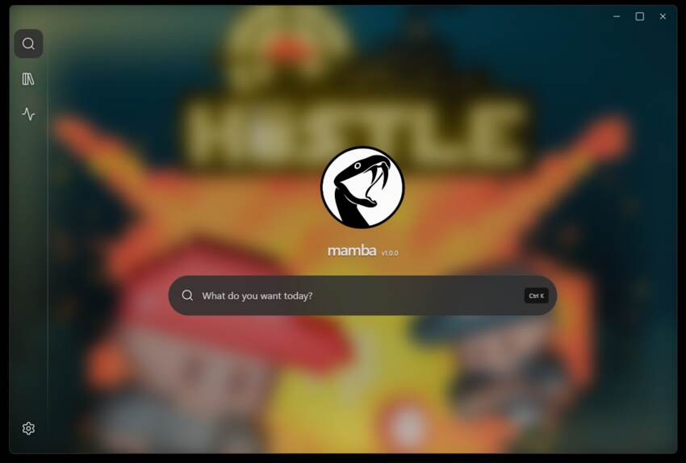
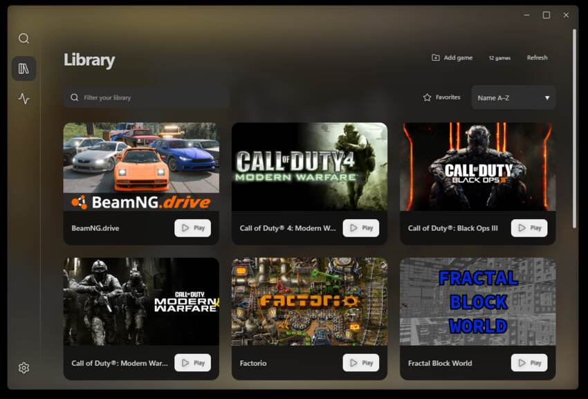
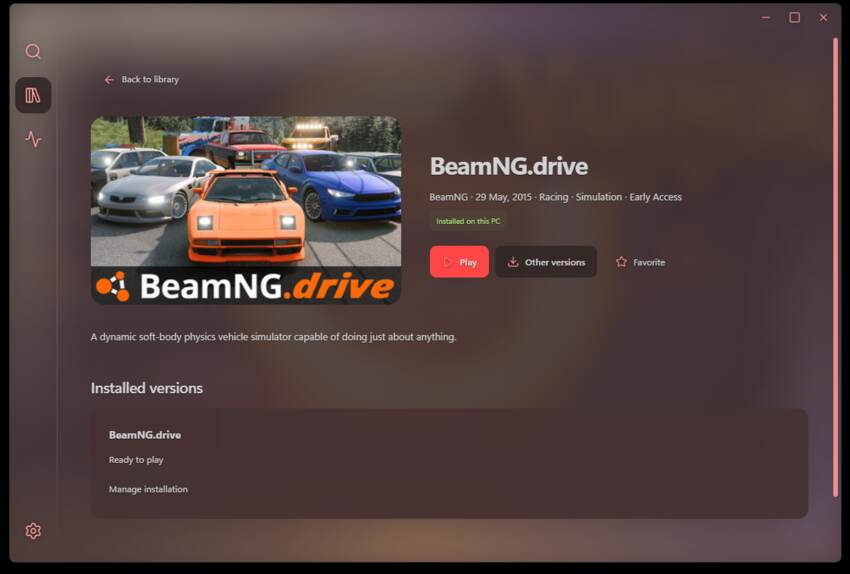
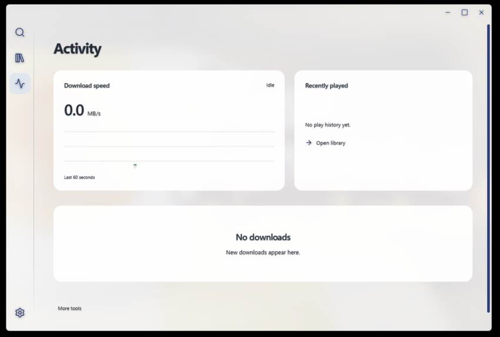

# Mamba Launcher

 

## What if Hydra's heads never grew back?

### A simpler, download-focused alternative to Hydra Launcher.

**Mamba Launcher** is a lightweight Windows game downloader inspired by [Hydra Launcher](https://github.com/hydralauncher/hydra).

While Hydra aims to be an all-in-one gaming platform, Mamba takes a different approach: **actually downloading the games**

## Screenshots

| Launcher | Game library |
|---|---|
|  |  |

| Game details | Activity |
|---|---|
|  |  |

## Features

### Game Discovery
