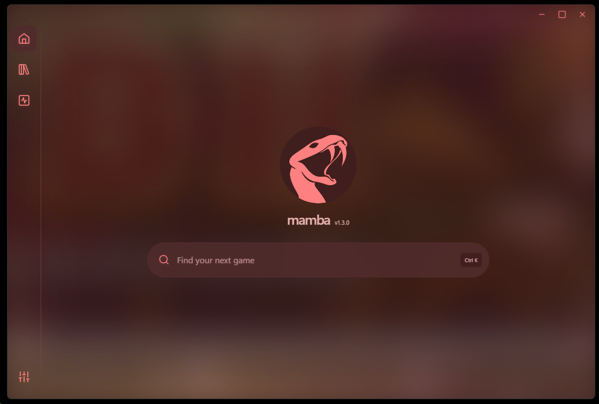
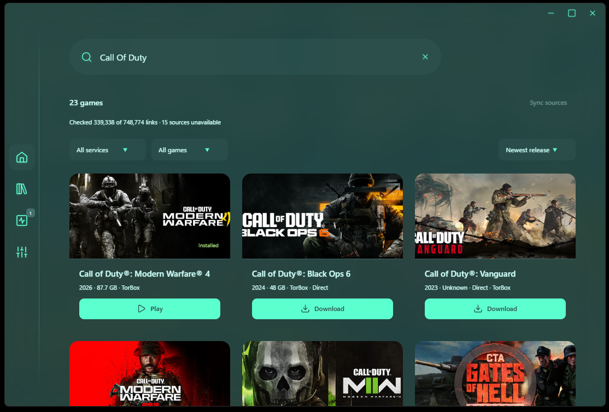
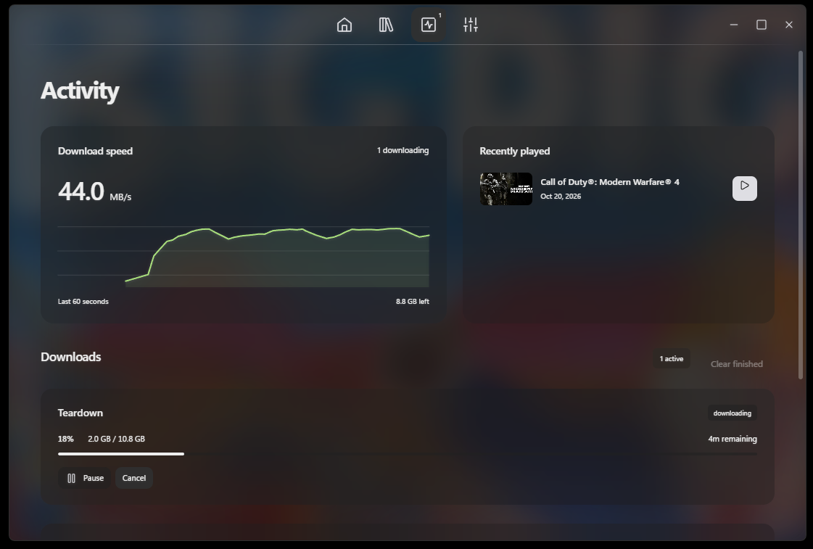

<div align="center">


# Mamba Launcher

A download-focused game launcher with source management, installation tools, and a customizable library.

<p><a href="https://github.com/shall0e/Mamba/releases/latest"></a>
<a href="https://github.com/shall0e/Mamba/releases"></a>
<a href="https://github.com/shall0e/Mamba/stargazers"></a>
<a href="https://github.com/shall0e/Mamba/issues"></a></p>

**[Download](https://github.com/shall0e/Mamba/releases/latest) &nbsp; · &nbsp; [Quick start](#quick-start) &nbsp; · &nbsp; [Screenshots](#screenshots) &nbsp; · &nbsp; [Features](#features) &nbsp; · &nbsp; [CLI](#mambacli) &nbsp; · &nbsp; [Development](#development)**

</div>

## About Mamba

Mamba brings game discovery, downloads, and installation management into one desktop application. Inspired by [Hydra Launcher](https://github.com/hydralauncher/hydra), it focuses on the path from finding a download to launching an installed game.

Windows is the primary platform. Linux builds are also available, with limitations for Windows-specific setup and integrations.

## Quick start

1. Download the Windows installer from the [latest release](https://github.com/shall0e/Mamba/releases/latest) and run it.
2. Open **Settings → Sources** and add your source URLs, or use [MegaSource](#megasource).
3. Choose a download folder and configure any download service you use.
4. Search for a game, review its available downloads, and start a download.

The Windows installer includes MambaCLI. You don't need a separate Node.js installation to use the installed app or CLI.

For Linux packages and requirements, see [Linux builds](#linux-builds).

## Screenshots

<table>
<tr><th align="left" width="50%">Home</th><th align="left" width="50%">Library</th></tr>
<tr><td><a href="assets/screenshots/home.png"></a></td><td><a href="assets/screenshots/library.png"></a></td></tr>
<tr><th align="left" width="50%">Search</th><th align="left" width="50%">Activity</th></tr>
<tr><td><a href="assets/screenshots/search.png"></a></td><td><a href="assets/screenshots/activity.png"></a></td></tr>
</table>

## Features

| Area              | What Mamba offers                                                                              |
| ----------------- | ---------------------------------------------------------------------------------------------- |
| Discovery         | Search imported sources and review available releases from one interface.                      |
| Source management | Add source URLs, reuse cached results, and use a combined MegaSource feed.                     |
| Downloads         | Start downloads, track progress, review history, and collect diagnostics when something fails. |
| Installation      | Automatic folder unnesting and Steam library integration on Windows.                           |
| Library           | Browse installed games and open their details or launch them.                                  |
| Appearance        | Customize colors, opacity, blur, and fonts through themes.                                     |
| Command line      | Search, inspect releases, download, manage sources, and resume jobs with MambaCLI.             |

Source availability and service compatibility determine which releases can be downloaded. Windows-specific installation tools and integrations are unavailable on Linux.

## MegaSource

MegaSource combines public source feeds into one URL. Add this in **Settings → Sources**:

```text
https://github.com/shall0e/Mamba/releases/download/megasource/megasource.json
```

Use the combined feed instead of adding its individual component sources to avoid redundant downloads.

The feed is generated from [`config/mega-sources.json`](config/mega-sources.json) on GitHub every six hours. Reachable sources are published, and unavailable sources are recorded under `unavailableSources`. If every source fails, the previous publication is kept.

To change the feed, edit the public URLs in that configuration file. Never commit account keys or private URLs. To generate it locally:

```sh
node tools/build-megasource.cjs
```

## MambaCLI

The Windows installer adds `mamba` to your user PATH. Open a **new terminal** after installation:

```sh
mamba -help
mamba search "left 4 dead 2"
mamba info 550
mamba download steam:550
```

Search accepts game titles, Steam app IDs, and Steam store URLs. It uses the launcher's Steam-backed grouping and cached sources. Run `mamba sync` when you want to refresh sources explicitly.

| Command                                    | Purpose                                |
| ------------------------------------------ | -------------------------------------- |
| `mamba config list`                        | View settings with secrets hidden.     |
| `mamba config set downloadPath "D:\Games"` | Change the download folder on Windows. |
| `mamba sources add <URL>`                  | Add a source feed.                     |
| `mamba sync`                               | Refresh sources.                       |
| `mamba jobs`                               | List download jobs.                    |
| `mamba resume <job-id>`                    | Resume a job.                          |

The CLI supports `--json` output. Settings are located automatically; set `MAMBA_DATA_DIR` to override the data directory. The CLI queue is stored in its `cli` subdirectory.

**Downloads run in the foreground. Keep the terminal open until they finish.**

Debian packages install the CLI as `/usr/local/bin/mamba` when that name is available. AppImage users can extract the AppImage and run its `mamba-cli` wrapper. Linux can download Windows releases, but running their installers and using Windows integrations requires Windows.

From a source checkout with Node.js 22 or newer:

```sh
node tools/mamba-cli.cjs -help
```

## Development

Use **Node.js 22 or newer**, npm, and Git.

```sh
git clone https://github.com/shall0e/Mamba.git
cd Mamba
npm ci
npm start
```

On Windows, `START.cmd` stops running Mamba processes, updates the checkout with `git pull --ff-only`, and launches through the windowless startup helper. If the update fails, it keeps your local changes and does not start Mamba. Use `npm start` to launch directly without that update step.

### Build and check commands

| Command                | Purpose                                       |
| ---------------------- | --------------------------------------------- |
| `npm start`            | Run the app from source.                      |
| `npm run build`        | Create a local unpacked app.                  |
| `npm run release:win`  | Build a Windows installer without publishing. |
| `npm run build:linux`  | Build Linux packages without publishing.      |
| `node --test`          | Run automated tests.                          |
| `npm run format`       | Format source and documentation.              |
| `npm run format:check` | Check formatting.                             |

Generated builds are written to `dist/`. Release publication uses the manually dispatched GitHub release workflow; building locally does not publish a release.

<details>
<summary><strong>Project layout</strong></summary>

| Folder         | Contents                                                         |
| -------------- | ---------------------------------------------------------------- |
| `src/main`     | Electron entry, preload, worker entry, and OS integration        |
| `src/core`     | Catalog, downloads, installation, and service clients            |
| `src/renderer` | Pages, UI scripts, and stylesheets                               |
| `src/shared`   | Theme model, presets, and shared utilities                       |
| `assets`       | Branding, screenshots, fonts, and the Lucide license             |
| `tools`        | CLI, game setup helpers, build tools, and Windows launch scripts |
| `config`       | Example configuration and MegaSource inputs                      |
| `test`         | Automated checks                                                 |
| `data`         | Local configuration and caches, excluded from Git and builds     |
| `dist`         | Generated builds, excluded from Git                              |

Development data previously stored in the project root is moved to `data/` automatically. Installed apps continue using their existing user data directory.

</details>

### Bundled CreamInstaller

[CreamInstaller](https://github.com/FroggMaster/CreamInstaller) is bundled as a separate executable. Open it from **Settings → App** or a game's advanced installation controls.

With Automatic updates enabled, Mamba checks stable CreamInstaller releases once daily and verifies downloads before switching versions. The bundled copy works offline; failed updates leave the current copy available.

Local and GitHub builds use the version and SHA-256 recorded in `src/shared/cream-installer-release.json`. The build hook downloads that executable into the ignored `vendor/creaminstaller` cache. Its GPL v3 license and corresponding-source link are included in the packaged `creaminstaller` resources.

## Linux builds

GitHub's [build workflow](https://github.com/shall0e/Mamba/actions/workflows/build.yml) produces x64 AppImage and Debian packages in the **Mamba-Linux** artifact.

To build locally on Linux:

```sh
npm ci
npm run build:linux
```

Install system `7z` for archive extraction. Windows-only helpers and integrations are unavailable on Linux.

## Reporting issues

[Open an issue](https://github.com/shall0e/Mamba/issues) with your Mamba version, operating system, steps to reproduce, and any relevant error messages or download diagnostics. For interface problems, include a screenshot.

Remove service keys, tokens, and other private details before sharing logs or configuration.
