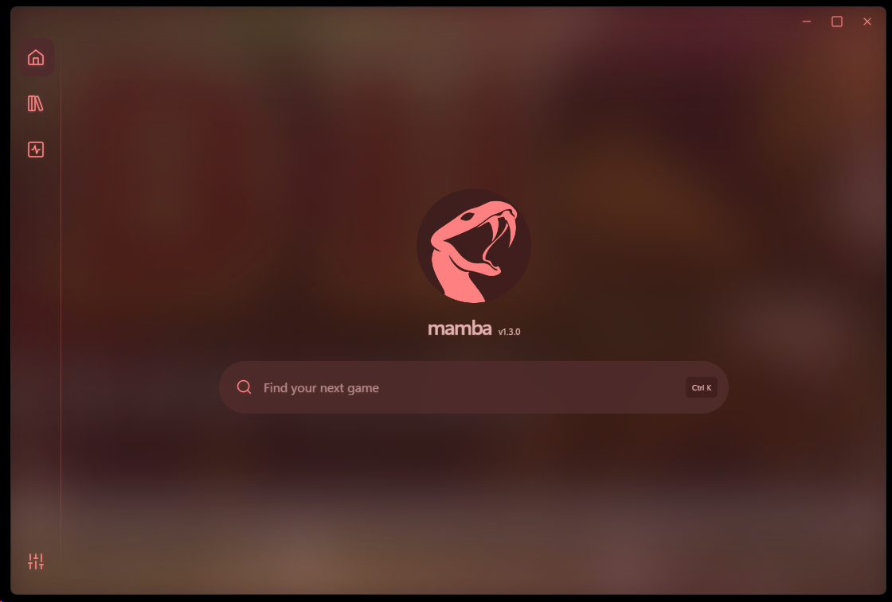
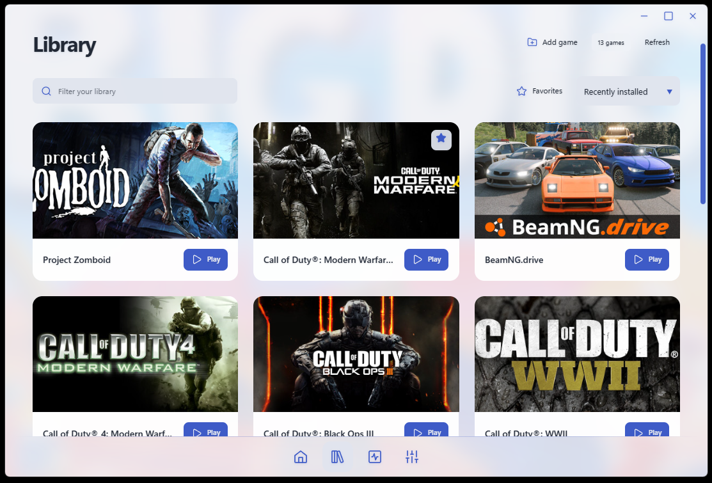
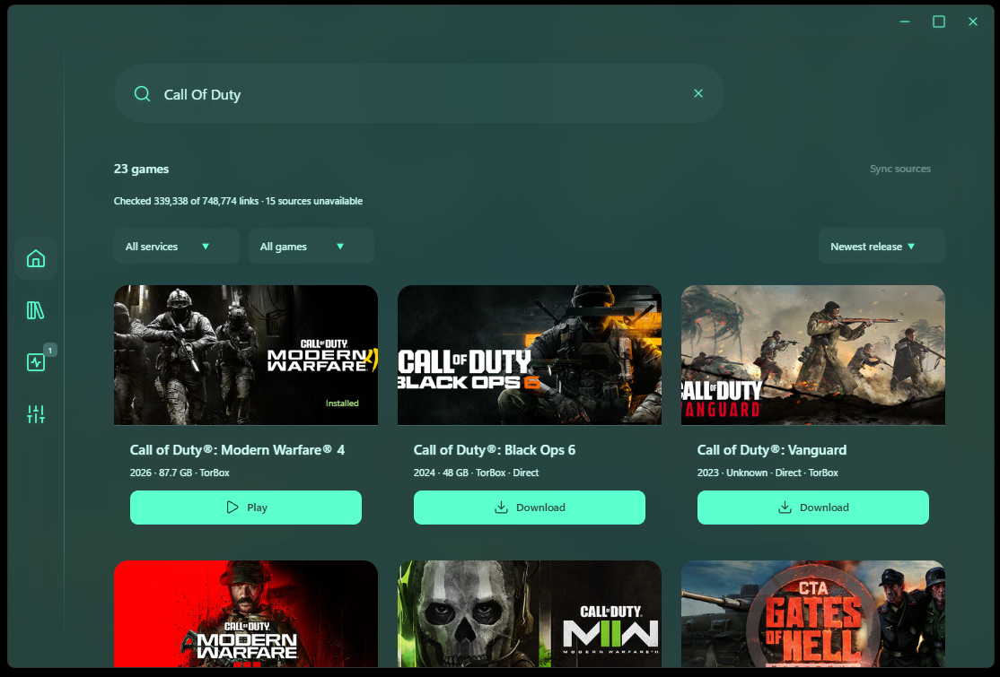
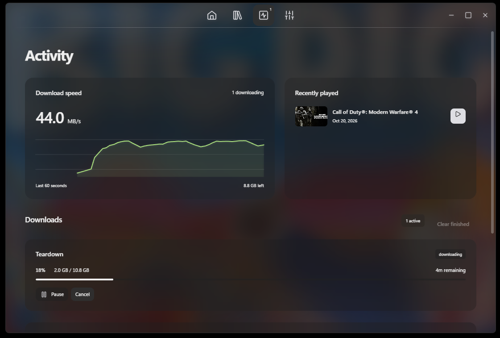

# Mamba Launcher

   

## What if Hydra's heads never grew back?

**Mamba Launcher** is a lightweight usage-focused Windows game downloader inspired by [Hydra Launcher](https://github.com/hydralauncher/hydra).

While Hydra aims to be an all-in-one gaming platform, Mamba takes a different approach: **actually downloading the games**

## Screenshots

| Home                                                                 | Library                                                                         |
| -------------------------------------------------------------------- | ------------------------------------------------------------------------------- |
|  |  |

| Search                                                                        | Activity                                                                               |
| ----------------------------------------------------------------------------- | -------------------------------------------------------------------------------------- |
|  |  |

## Features

### Game Discovery

- **Extensive game catalog** - Bring all of your Hydra links over, Mamba sorts through the garbage.
- **One-click downloads** - Just search and hit download.
- **Centralized interface** - Discover available downloads from one application.

### Download Management

- **Download progress tracking** - Monitor active downloads and their progress.
- **Download history** - Keep track of download activity.
- **Download diagnostics** - Collect troubleshooting information when downloads fail.

### Desktop Experience

- **Minimalist interface** - Designed around simplicity rather than extensive navigation.
- **Lightweight workflow** - Avoid the complexity of managing an entire gaming library.
- **Focused functionality** - Download games without distractions or unnecessary extras.
- **Customizability** - Make it yours and express yourself through color!

## Mamba vs. Hydra

| Feature                    | Mamba | [Hydra](https://github.com/hydralauncher/hydra) |
| -------------------------- | :---: | :---------------------------------------------: |
| Game library               |  ✅   |                       ✅                        |
| Game discovery             |  ✅   |                       ✅                        |
| One-click downloads        |  ✅   |                       ❌                        |
| Dead link removal          |  ✅   |                       ❌                        |
| Automatic unnesting        |  ✅   |                       ❌                        |
| Adding to Steam Library    |  ✅   |                       ❌                        |
| Automatic best source      |  ✅   |                       ❌                        |
| Download history           |  ✅   |                       ✅                        |
| Accurate download progress |  ✅   |                       ❌                        |
| Accounts                   |  ❌   |                       ✅                        |
| Friends                    |  ❌   |                       ✅                        |
| Cloud saves                |  ❌   |                       ✅                        |
| Achievements               |  ❌   |                       ✅                        |
| Subscription service       |  ❌   |                       ✅                        |

## Development

Run `npm ci` then `npm start`. On Windows, `START.cmd` launches without a terminal.

- `npm run build`: create a local unpacked app.
- `npm run release:win`: build an installer without publishing.
- `npm run format` / `npm run format:check`: format source / check formatting.

### Project layout

| Folder         | Contents                                                     |
| -------------- | ------------------------------------------------------------ |
| `src/main`     | Electron entry, preload, worker entry, OS integration        |
| `src/core`     | Catalog, downloads, installation, service clients            |
| `src/renderer` | Pages, UI scripts, stylesheet                                |
| `src/shared`   | Theme model, presets, shared utilities                       |
| `assets`       | Branding, screenshots, Lucide license                        |
| `tools`        | Game setup helper and Windows launch scripts                 |
| `config`       | Example configuration                                        |
| `test`         | Automated checks                                             |
| `data`         | Local configuration and caches, excluded from Git and builds |
| `dist`         | Generated builds, excluded from Git                          |

Development data previously stored in the project root is moved to `data/` automatically. Installed apps continue using their existing user data directory.
